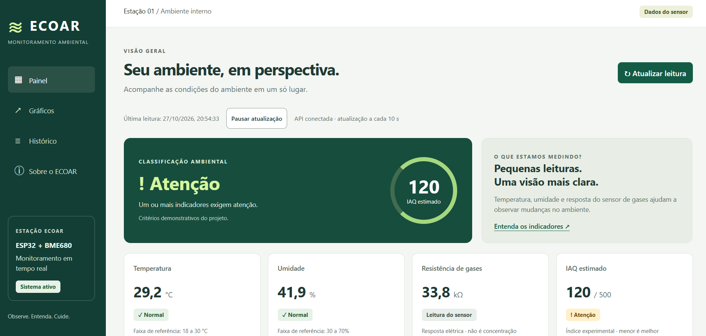
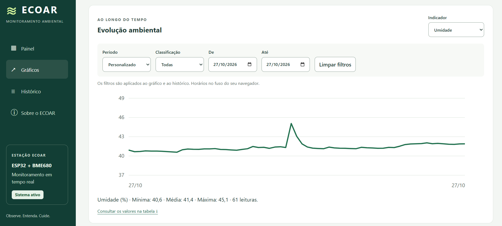
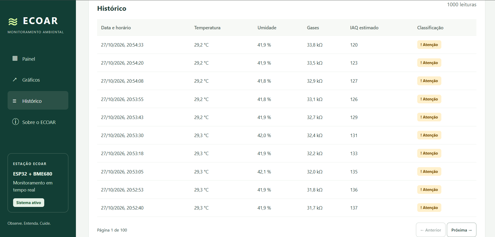
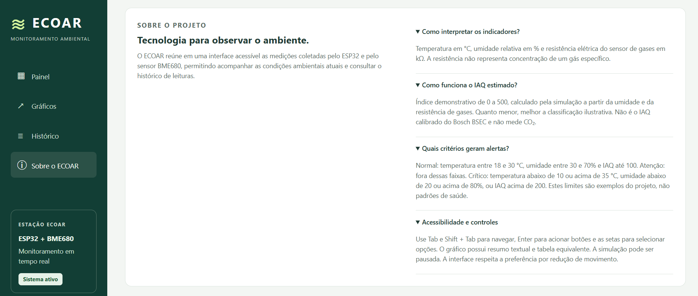
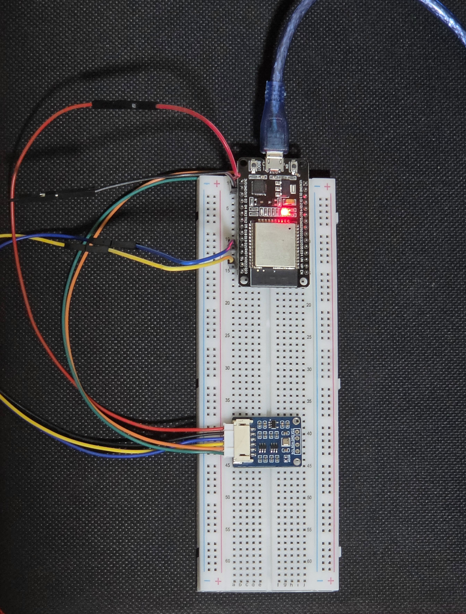

# 🌿 ECOAR — Monitoramento Ambiental Interno

O **ECOAR** é um sistema experimental de baixo custo desenvolvido para monitorar condições ambientais em espaços internos, especialmente durante o período de estiagem em Manaus.

O sistema utiliza o sensor ambiental **BME680** e o microcontrolador **ESP32** para coletar valores de temperatura, umidade relativa do ar e resistência do sensor de gases. As leituras são enviadas pela rede Wi-Fi para uma API, processadas pelo back-end e armazenadas no banco de dados Supabase.

## 🔗 Acesso ao sistema

O painel web do ECOAR está disponível em:

[https://ecoar-painel-ambiental.onrender.com/](https://ecoar-painel-ambiental.onrender.com/)

> Como o sistema utiliza serviços gratuitos de hospedagem, o carregamento inicial pode levar alguns segundos após períodos sem utilização.

## 🖥️ Interface do sistema

A interface web permite acompanhar as condições ambientais atuais, consultar o histórico das medições e analisar as alterações registradas ao longo do tempo.

### Painel principal

O painel apresenta a medição mais recente, incluindo temperatura, umidade relativa do ar, resistência do sensor de gases, IAQ estimado, classificação ambiental, status do sistema e horário da última atualização.



### Gráficos das medições

A página de gráficos apresenta o comportamento das variáveis monitoradas durante o período selecionado, facilitando a identificação de mudanças nas condições do ambiente.



### Histórico de leituras

O histórico reúne as medições registradas pelo sistema, apresentando temperatura, umidade, resistência do sensor de gases, IAQ estimado, classificação, data e horário.



### Sobre o ECOAR

A página “Sobre” apresenta o objetivo do projeto, os componentes utilizados, o funcionamento da solução e as limitações do índice estimado de qualidade do ar.



## 🔌 Protótipo físico

O protótipo é composto pelo sensor ambiental BME680, pelo microcontrolador ESP32, pela protoboard e pelos jumpers de conexão. O sensor realiza as leituras ambientais e o ESP32 transmite os dados pela rede Wi-Fi para a API do ECOAR.



## ⚙️ Funcionalidades

- Medição da temperatura do ambiente;
- Medição da umidade relativa do ar;
- Obtenção da resistência do sensor de gases;
- Envio das leituras pelo ESP32 por meio da rede Wi-Fi;
- Validação e processamento das medições no back-end;
- Cálculo de um IAQ estimado;
- Classificação ambiental em Normal, Atenção, Desconfortável ou Crítico;
- Registro das medições com data e horário;
- Apresentação da condição ambiental atual;
- Consulta ao histórico de medições;
- Visualização de gráficos das variáveis monitoradas;
- Apresentação de alertas para classificações mais críticas;
- Interface adaptável para computador e celular.

## 🏗️ Arquitetura do sistema

O fluxo de funcionamento do ECOAR ocorre da seguinte forma:

```text
BME680 → ESP32 → Wi-Fi → API/Back-end → Supabase → Interface web
```

1. O BME680 coleta temperatura, umidade relativa e resistência do sensor de gases.
2. O ESP32 recebe as leituras e as envia pela rede Wi-Fi.
3. A API valida e processa os valores recebidos.
4. O back-end calcula o IAQ estimado e determina a classificação ambiental.
5. As medições são armazenadas no Supabase com data e horário.
6. A interface web consulta e apresenta os dados registrados.

## 📁 Estrutura do projeto

```text
ECOAR/
├── back-end/
│   ├── src/
│   ├── package.json
│   └── package-lock.json
├── esp32/
│   └── ECOAR_BME680/
├── front-end/
│   ├── index.html
│   ├── styles.css
│   └── app.js
├── imagens/
│   ├── gráfico-ecoar.png
│   ├── historico-ecoar.png
│   ├── painel-ecoar.png
│   ├── prototipo-ecoar.jpg
│   └── sobre-ecoar.png
└── README.md
```

## 🛠️ Tecnologias utilizadas

### Hardware

- ESP32;
- Sensor ambiental BME680;
- Protoboard;
- Jumpers;
- Cabo USB.

### Software

- Arduino IDE;
- HTML;
- CSS;
- JavaScript;
- Chart.js;
- Node.js;
- Express;
- Supabase;
- Render;
- Git e GitHub.

## 💾 Banco de dados

O armazenamento das medições é realizado no **Supabase**, um serviço de banco de dados online. Cada registro mantém:

- Temperatura;
- Umidade relativa do ar;
- Resistência do sensor de gases;
- IAQ estimado;
- Classificação ambiental;
- Data e horário da medição.

## 🚀 Execução local

### Pré-requisitos

Para executar o sistema localmente, são necessários:

- Node.js;
- npm;
- Arduino IDE;
- Bibliotecas do BME680 instaladas;
- Credenciais de acesso ao Supabase;
- Rede Wi-Fi para comunicação do ESP32.

### Back-end

Clone o repositório:

```bash
git clone https://github.com/erikaaabastos/ECOAR.git
```

Entre na pasta do back-end:

```bash
cd ECOAR/back-end
```

Instale as dependências:

```bash
npm install
```

Configure as variáveis de ambiente no arquivo `.env`:

```env
SUPABASE_URL=sua_url_do_supabase
SUPABASE_KEY=sua_chave_do_supabase
API_KEY=sua_chave_da_api
```

Inicie o servidor:

```bash
npm start
```

A aplicação local poderá ser acessada em:

```text
http://localhost:3000
```

### ESP32

No projeto da ESP32, crie o arquivo `secrets.h` com as informações da rede e da API:

```cpp
#define WIFI_SSID "nome_da_rede"
#define WIFI_PASSWORD "senha_da_rede"
#define API_KEY "chave_da_api"
```

Depois:

1. Conecte o ESP32 ao computador;
2. Abra o código no Arduino IDE;
3. Selecione a placa e a porta correspondentes;
4. Compile e envie o código;
5. Abra o Monitor Serial na velocidade de 115200 baud;
6. Verifique a conexão Wi-Fi e o envio das medições para a API.

> Os arquivos `.env` e `secrets.h` possuem informações confidenciais e não devem ser publicados no repositório.

## 💰 Custo do protótipo

O protótipo foi desenvolvido com componentes de baixo custo e fácil integração. O valor total aproximado dos materiais utilizados foi de **R$ 222,60**, considerando o ESP32, o sensor BME680, a protoboard, o cabo USB e os componentes de conexão.

## ⚠️ Limitações

O IAQ apresentado pelo ECOAR é uma **estimativa experimental**, calculada a partir da resposta do sensor de gases e da umidade relativa do ar. O índice não corresponde ao IAQ oficial produzido pela biblioteca Bosch BSEC.

O sistema:

- Não identifica gases específicos;
- Não realiza medição direta de dióxido de carbono;
- Não mede material particulado;
- Não apresenta diagnóstico médico;
- Não substitui equipamentos profissionais de análise ambiental;
- Não utiliza a pressão atmosférica na análise ou na classificação.

## 👩‍💻 Integrantes

- Érika Bastos de Vasconcelos;
- Sheila Bianca de Carvalho Freitas.

## 👩‍🏫 Orientação

**Profa. MBA Luana Leal**

## 📚 Contexto acadêmico

Projeto desenvolvido como parte do Trabalho de Conclusão de Curso, com o objetivo de propor uma solução acessível para o acompanhamento das condições ambientais em ambientes internos de Manaus.
